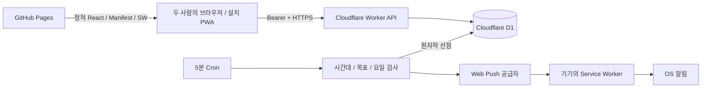

# 설계와 보안 판단



## 인증과 데이터 격리

- 무작위 UUID는 식별자이며 인증 수단이 아니다. 별도의 crypto.getRandomValues 256비트 세션 토큰으로 인증한다.
- 무작위 세션/초대/복구 코드를 SHA-256으로 검증한다. 사람 비밀번호가 아니므로 느린 비밀번호 KDF 대신 고엔트로피 비밀의 해시를 사용한다.
- 세션 조회는 users와 group_members를 JOIN한다. 모든 기록 쿼리에 서버가 조회한 그룹·사용자 범위를 적용한다.
- `group_members`에는 사용자 UNIQUE 제약, 그룹당 최대 2명 INSERT 트리거가 있다. 새 사용자·설정·멤버십·세션 생성은 D1 batch 원자성에 의존한다. 실패한 참여가 고아 사용자를 남기지 않는다.
- 복구는 이전 hash를 조건으로 새 hash를 저장한 뒤, 새 hash 소유자만 기존 세션을 취소하고 새 세션을 생성한다. 한 트랜잭션이므로 동시 복구 중 하나만 새 세션을 얻는다.
- 기본 만료 365일. 복구 시 기존 세션이 즉시 무효화된다. 로그아웃/사용자 삭제/멤버 탈퇴/공간 교체는 현재 범위에 포함하지 않는다.

## 브라우저 저장과 XSS/CSRF

GitHub Pages와 workers.dev 간에는 third-party 쿠키 정책이 달라 장기간 게스트 인증이 불안정할 수 있다. 따라서 브라우저 localStorage의 Bearer 토큰을 선택했다. 토큰은 base 경로별 별도 키에 저장한다. 동일 origin의 다른 스크립트와 XSS는 토큰에 접근할 수 있으므로 이것은 HttpOnly와 동등한 보안이 아니다.

React text escaping을 사용하고 HTML 주입 기능을 사용하지 않는다. 외부 스크립트/추적기/폰트를 포함하지 않는다. CSP는 build 시 API origin을 넣은 메타로 제공한다. 메타 CSP는 frame-ancestors를 지원하지 않으므로 정적 Pages에서 클릭재킹 방어 헤더는 보장하지 않는다. GitHub 계정·저장소 접근권한과 의존성 공급망 관리가 중요하다.

브라우저는 Authorization 토큰을 자동으로 첨부하지 않는다. 타 사이트의 단순 form POST에는 이 토큰이 없고 JSON Content-Type도 요구한다. Origin이 있는 요청은 정확한 허용 origin과 일치해야 한다. Origin이 없는 CLI 요청도 토큰 검증을 통과해야 한다. CORS만으로 인증하지 않는다.

## 푸시 데이터 보호

- D1은 endpoint hash만 평문으로 색인하며 endpoint/keys JSON은 AES-256-GCM 암호화한다. 매 저장에 새로운 96비트 IV를 사용한다.
- 동일 endpoint를 다른 사용자에게 이전하는 upsert를 금지한다.
- 사용자당 활성 기기 최대 3대. 재활성화 UPDATE에도 같은 제약이 적용된다.
- 공급자 hostname을 정확히 제한하고 https, 기본 port, 사용자 정보 없음, redirect 거부를 적용해 SSRF를 줄인다.
- 푸시는 payload 없이 전송한다. VAPID는 P-256 ES256 JWT이며 aud=공급자 origin, 유효기간 1시간. JWT는 isolate 메모리에서 재사용해 반복 서명 비용을 줄인다.
- 제목과 내용은 SW의 고정 문구다. 공급자가 알게 되는 것은 해당 endpoint로 알림을 보냈다는 사실과 시점이다.

## 예약 상태 기계

```text
새 슬롯 → D1 UNIQUE INSERT로 sending 선점 → 공급자 POST
  2xx       → accepted + sent_at
  404/410   → expired + 구독 revoked_at
  429/5xx   → retry (5분 뒤, 총 3회 이내) → sending CAS → ... → failed
  다른 HTTP → failed
  네트워크 불명 → unknown (중복 위험 때문에 재전송 안 함)
  15분 이상 sending → unknown (작업 중단, 재선점 안 함)
  설정 변경/시간 외/목표 달성 → cancelled (대기 retry)
```

선점 INSERT와 재시도의 조건부 UPDATE가 동시 실행에서 1개 작업만 이기도록 한다. 외부 HTTP와 D1을 하나의 트랜잭션으로 묶을 수 없으므로 정확히 한 번의 기기 표시 보장은 없다. 요청 성공 후 DB 저장 전에 Worker가 중단되면 sending→unknown이 되고 다시 보내지 않는다. 반대로 전송 전 중단이면 누락될 수 있다. 이미 전송 중인 요청은 사용자가 설정을 끄더라도 회수할 수 없다.

기기 2대에는 각 1개의 예약을 만든다. 하나가 만료되어도 다른 기기를 별도로 처리한다. SW notification tag는 `water-reminder`로 새 알림이 오래된 알림을 대체할 수 있다.

## 데이터 보존과 운영

- 수분 기록과 계정은 자동 삭제하지 않는다. 합계는 원본에서 계산한다.
- 발송 로그는 30일 보존. 03:00 UTC Cron에서 만료 세션/요청 제한 bucket/오래된 발송 로그를 정리한다.
- 모든 입력은 서버 검증·SQL 바인딩. body 8KB 제한은 실제 stream byte 수로 적용한다.
- Observability 로그는 기본 비활성화. 운영 지표를 켤 경우 요청 header/body를 기록하지 않는다. 에러 문자열에 DB bind나 endpoint가 노출되지 않도록 일반 오류로 변환한다.
- 알림 연결 실패/403/권한 거부는 UI에 표시한다. HTTP 전송 요청 수락을 실제 표시 성공으로 바꾸어 표현하지 않는다.
- 무료 한도 측정은 실제 Cloudflare CPU 및 D1 metrics로 수행한다. 로컬 Miniflare는 무료 CPU 10ms 제한을 재현하지 않는다.

## 후속 운영 검증

공개 배포 후 CORS 차단, HTTPS, Secret 미포함 번들, Cloudflare CPU, D1 일일 행 사용량, 두 Android 기기의 실제 푸시를 점검한다. 매우 많은 그룹을 공개 모집하는 서비스는 설계 범위가 아니다. 그런 용도에는 signup 보호, 작업 분할, 관찰 가능한 오류 지표, 보존 정책을 추가해야 한다.
