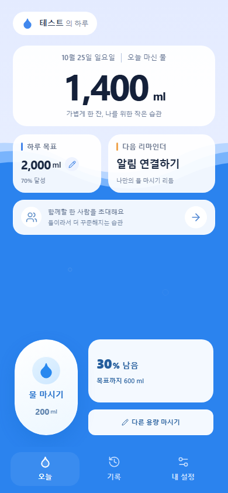
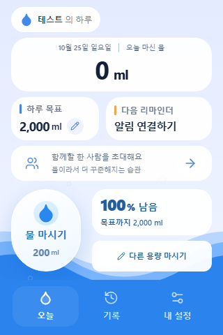
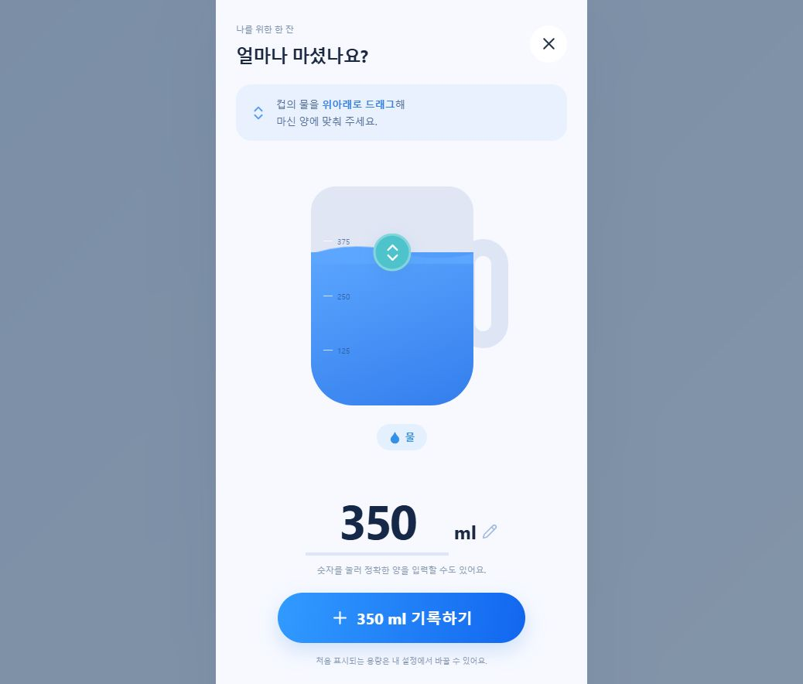
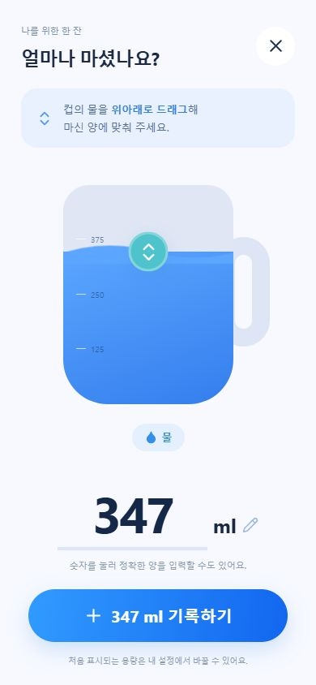
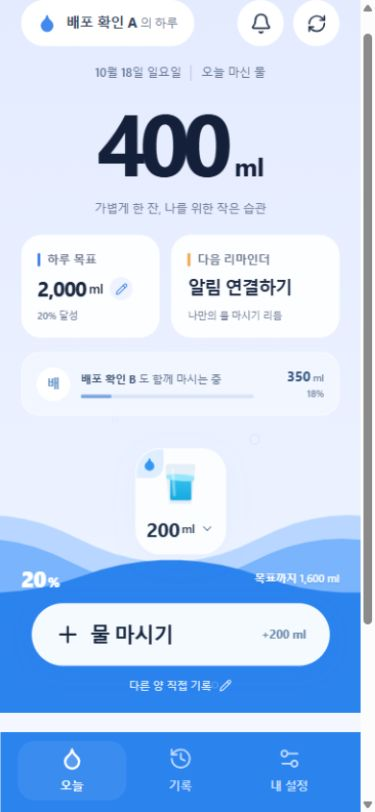
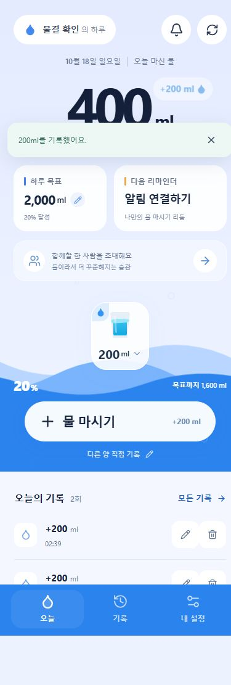
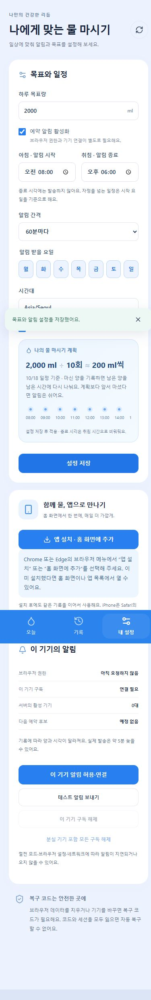
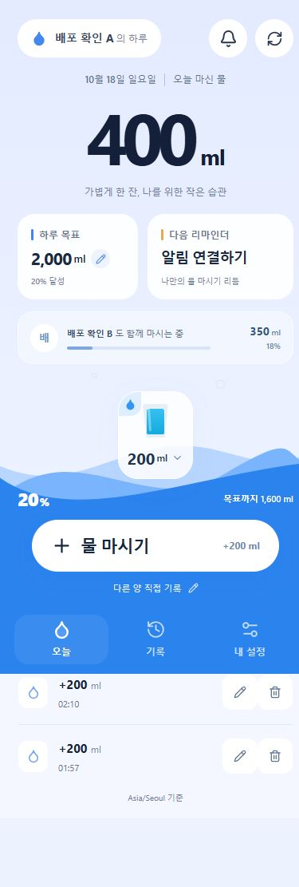
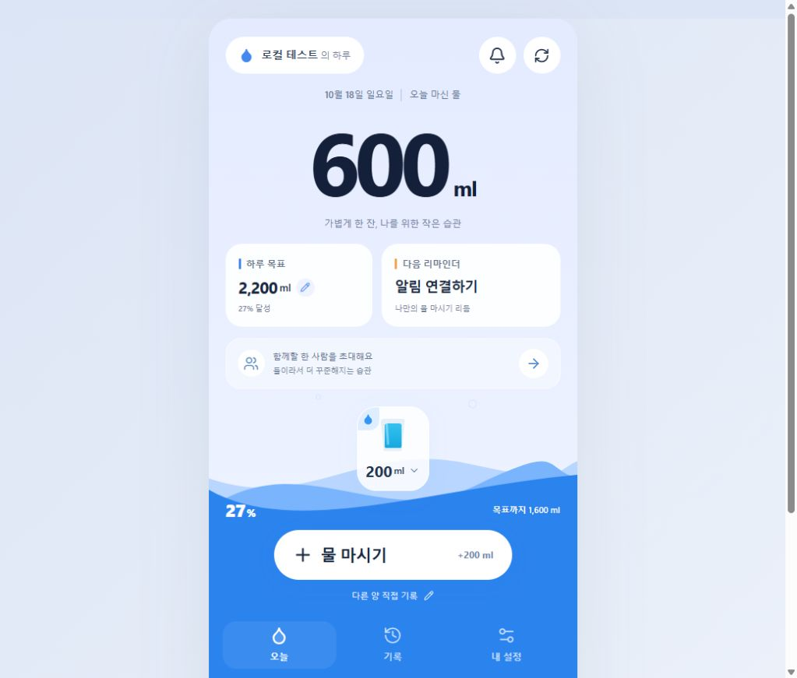
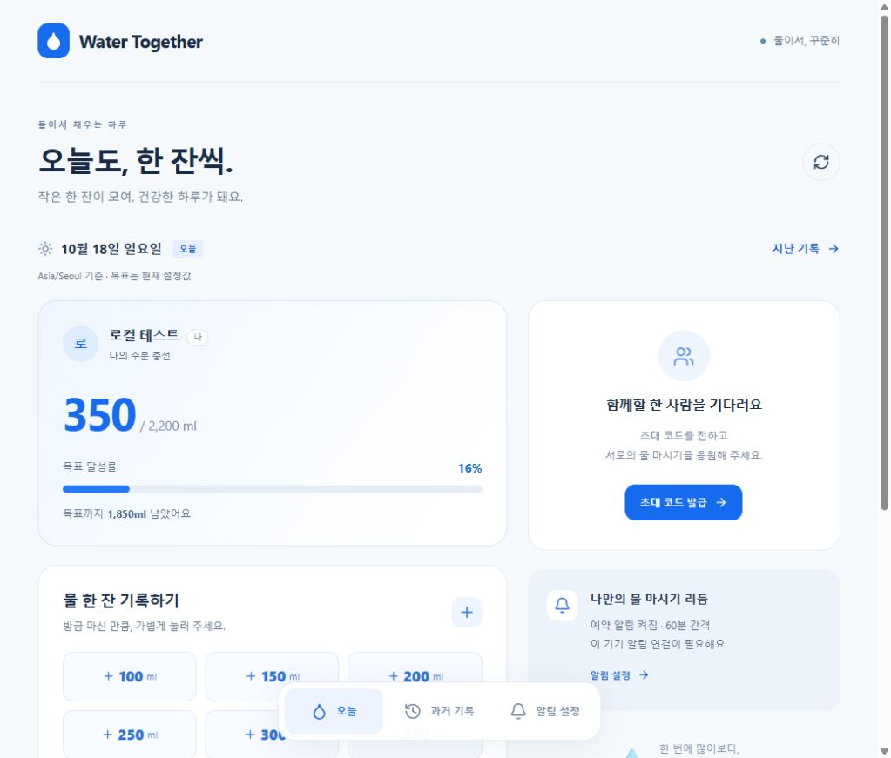

## 2026-10-26 설정 자동 저장

- 목표·시간·알림 설정의 변경은 화면에 즉시 반영하고, 설정 하위 탭/주 메뉴 이동, 앱 백그라운드 전환, 새로고침·페이지 종료 때 변경분을 한 번에 D1 설정 API로 보낸다. 일반 저장 버튼은 제거했다.
- 전송 전에 설정 초안을 계정별로 브라우저에 임시 보관한다. 종료 중 네트워크 요청이 완료되지 않거나 저장이 실패하면 다음 앱 실행·온라인 복귀 시 재시도한다. 종료 시 저장 완료 자체는 브라우저가 보장하지 않는다.
- 연속 편집은 하나의 요청으로 묶이고, 전송 중 다시 편집하거나 원복하면 마지막 값을 후속 요청으로 저장한다. 실패 시에는 안내와 다시 시도 버튼이 표시된다. 기기 물소리, 닉네임 변경 등 별도 저장 흐름은 이 설정 초안에 포함되지 않는다.
- `npm run check`: 타입 검사, 자동 저장 경합·복원·실패 재시도를 포함한 43개 테스트, 프론트/PWA 빌드와 Worker dry-run 통과. 로컬 Chrome과 D1에서 목표량·기본 한 잔을 연속 수정한 뒤 주 메뉴 이동으로 저장, 알림 설정 변경 뒤 하위 탭 이동으로 저장, 새로고침 후 값 유지를 확인했다.

## 2026-10-26 설정 버튼에서 용량 선택창 열기 및 상한 변경

- 목표 설정의 두 컵을 제거하고 기존 숫자 필드 모양의 버튼을 복원했다. 버튼을 누르면 물 마시기와 공통인 `AmountSheet`가 열려 컵 드래그·숫자 입력·방향키를 사용할 수 있다. 취소는 초안을 바꾸지 않고, 적용은 초안에만 반영하며 기존 저장 버튼을 유지한다.
- 하루 목표 100–5,000ml, 기본 한 잔 및 한 번의 섭취 기록/수정 1–500ml를 UI와 API에서 제한한다. 과거 초과 설정은 조회/계산에서 정규화하고 이후 설정 저장 때 반영한다. 기존 섭취 기록과 누적 합계는 그대로 보존하며 DB 마이그레이션은 없다.
- 운영 경로 환경의 `npm run check`: 39개 테스트·타입 검사·프론트/PWA 빌드·Worker dry-run 통과. 경계값 500/501, 5,000/5,001, 구버전 설정 조회/저장, 과거 1,500ml 기록/합계 보존을 API 테스트로 확인했다.
- Computer Use로 Chrome에서 로컬 모의 API와 연결해 버튼 열기, 큰 컵 표시, 드래그(200→350ml), 취소 후 원래 값 유지, 직접 입력 초과 차단, End/ArrowUp 최대값 유지, 337ml 적용, 설정 적용 전 저장/물 기록 API 호출 0건을 확인했다. 저장 실패 시 초안/저장 버튼 유지, 재시도 성공 후 저장 버튼 숨김, 물 마시기 초기값 337ml 및 500ml 기록도 확인했다.
- 390×844 화면과 320×568 화면에 가로 넘침이 없고, 작은 화면의 선택창은 세로로 스크롤된다. Chrome 실행 오류 0건. 결과 화면: `C:/Users/USER/water-ui-qa/amount-sheet-review/settings.jpg`, `cup-dialog.jpg`. 실계정·푸시를 사용하지 않은 로컬 UI 검증이다.
- 운영 반영: 프론트 `87987e2`, Pages `40252959763` 및 Checks `40252959838` 성공. Worker `85a6315b-3f2d-46df-a537-44810cef6b9f` 배포와 health 200 확인. 공개 앱의 JS/CSS는 로컬 검증 빌드와 바이트 단위로 일치하며 알림 투명 아이콘 수정도 유지된다. `amount-sheet-review/production.json`에 결과를 기록했다. 실계정 저장 검증은 하지 않았다.

## 2026-10-26 알림 오른쪽 사이트 이니셜 숨김

- 사용자가 테스트 알림 오른쪽에 `(B)`가 표시된다고 보고했다. 기존 `icon` 생략 처리는 큰 아이콘을 숨기지 못했다. [Chromium NotificationBuilderBase](https://chromium.googlesource.com/chromium/src/+/98bcd85e696b5a2b236e706204da0e9936d6e1b1/chrome/browser/notifications/android/java/src/org/chromium/chrome/browser/notifications/NotificationBuilderBase.java)의 `ensureNormalizedIcon`은 이미지가 없으면 출처 기반 아이콘을 생성한다. 운영 주소의 `B`가 표시된 원인으로 판단했다.
- SW에 완전 투명한 96×96 PNG를 지정하고 생성 스크립트·PWA 캐시·콘텐츠 해시에 포함했다. 작은 물방울 badge와 기존 알림 동작은 유지한다. 기존 SW 검사는 새 아이콘 URL, PWA 검사는 모든 픽셀의 투명도와 캐시 포함을 확인하도록 갱신했다.
- `npm run check`: 타입 검사, 기존 38개 테스트, 운영 `/water-together/` 경로의 프론트/PWA 빌드, Worker dry-run 모두 통과했다. 변경 코드의 Prettier와 `git diff --check`도 통과했다.
- 운영 반영: `18c5400`, Pages `40251516621` 및 Checks `40251516595` 성공. 공개 앱의 두 알림 PNG는 로컬과 바이트 단위로 일치했고, SW는 빌드별 캐시 리비전을 제외한 내용이 일치했다. 투명 아이콘의 모든 9,216개 픽셀 alpha=0과 캐시 포함을 확인했다. 배포 SW 리비전은 `aef23e2045318664`. 결과는 `C:/Users/USER/water-ui-qa/notification-empty-icon-production/results.json`.
- 실제 휴대폰 알림 외형은 미검증이다. 앱에서 새 버전을 적용한 뒤 기존 알림을 지우고 새 테스트 알림으로 확인해야 한다. 투명 이미지를 사용하므로 기기에 따라 오른쪽 빈 공간은 남을 수 있다.

## 2026-10-26 하루 목표와 기본 한 잔을 컵 드래그로 설정

- 목표 설정의 두 숫자 입력창을 물 마시기와 같은 컵 드래그로 교체했다. 용량은 읽기 전용 숫자로 보여주며 목표 100ml / 한 잔 10ml씩 드래그와 ± 버튼으로 조절한다. 방향키 1ml, Shift+방향키 10ml, Home/End 최솟값/최댓값도 지원한다. 기존 저장 범위(100–10,000ml / 1–3,000ml)와 비정형 정수 초기값을 유지한다.
- 공통 `MugSlider.tsx`는 포인터 캡처, 터치, 키보드, 취소/캡처 해제, 비활성 상태를 처리한다. 설정 탭 스와이프는 컵 조작을 제외하며 기존 물 마시기 숫자 입력/확정 흐름도 유지한다.
- `npm run check` 통과: 타입 검사, 기존 38개 테스트, 프론트/PWA 빌드, Worker dry-run. 프론트 변경이며 Worker/DB 변경은 없다.
- 격리된 Chrome과 모의 API로 320×480, 360×640, 390×844, 430×932, 768×1024, 1440×900을 확인했다. 가로 넘침 없이 두 컵과 용량/버튼이 표시된다. 마우스와 CDP 터치 드래그, 탭 이동 후 편집값 유지, 원복 시 저장 버튼 숨김, 전체 범위/키보드, ± 버튼, 저장 중 비활성화를 확인했다.
- 저장/새로고침 후 복원, 기본 한 잔 290ml의 물 마시기 초기값 반영, 물 마시기 터치 드래그/취소/375ml 저장도 확인했다. 2,137ml/273ml의 기존 값 보존, 실패 시 편집 유지, 오프라인 저장 차단, 재시도 성공을 포함하며 브라우저 실행 오류는 0건이다. 검증은 가상 데이터만 사용했다.
- 검증 스크립트: `C:\Users\USER\water-ui-qa\goal-drag-review.mjs`. 결과와 화면: `C:\Users\USER\water-ui-qa\goal-drag-review\`. 실제 휴대폰 터치 하드웨어 검증은 포함하지 않는다.
- 운영 반영: `6dc057d`, Pages `40250232482` 및 Checks `40250232408` 성공. 운영 경로 `/water-together/` 프론트/PWA 빌드도 확인했다. 공개 앱에서 동일한 6개 화면 크기와 전체 입력/저장/실패/재시도/물 마시기 흐름을 모의 API로 다시 검증했고 브라우저 실행 오류는 0건이었다. 운영 검증 결과와 PNG: `C:\Users\USER\water-ui-qa\goal-drag-production\`.

## 2026-10-26 변경된 설정이 있을 때만 저장 버튼 표시

- 편집 중인 값과 클라이언트의 저장된 설정을 필드별로 비교해 변경이 있을 때만 하단 저장 영역을 렌더링한다. 기본값 생략, 요일·알림 배열 순서 차이는 변경으로 보지 않는다. 변경 없는 폼 제출은 API 요청을 보내지 않는다.
- `npm run check` 통과: 타입 검사, 기존 38개 테스트, 프론트/PWA 빌드, Worker dry-run 빌드. 변경한 TS/TSX의 Prettier 검사와 `git diff --check`도 통과했다.
- 격리된 Chrome 390×844와 모의 API에서 17개 상태를 확인했다. 최초 진입·같은 기본 시간 재설정에는 버튼이 없으며 목표·시간·요일·알림 변경에는 표시되고 원복하면 사라진다. 저장 성공 후 사라짐, 새 저장값 기준 재편집·원복, 변경 없는 제출 시 추가 PUT 없음, 저장 실패 후 버튼 유지, 함께하기 탭에서 숨김과 목표 탭 복귀 시 편집 유지도 확인했다. 실행 오류와 가로 넘침은 없었다.
- 실제 사용자 설정이나 운영 API는 검증에 사용하지 않았다. Worker/DB 변경은 없다.
- 운영 반영: `178ca85`, Pages `40248577673` 및 Checks `40248577667` 성공. 공개 앱 번들 `index-CwoYqNeX.js`에서 모의 API로 7개 상태를 확인했다. 최초 진입·원복·저장 성공 후 버튼 숨김, 편집 시 표시, 알림 배열 순서 및 요일 재선택에 따른 순서 차이 무시를 확인했으며 실행 오류는 0건이었다.

## 2026-10-26 앱·알림 아이콘을 물 마시기 버튼과 통일

- 앱 아이콘·favicon·Apple 아이콘과 상태 표시줄 badge를 물 마시기 버튼의 Lucide `Droplet`(채움, strokeWidth 1.5)로 통일했다. 앱 아이콘은 `#2888ef`/`#e4ebff`, badge는 흰색/투명 배경이며 별도 하이라이트를 제거했다. 생성 PNG를 열어 색상과 모양을 확인했다.
- Manifest와 SW 캐시를 `icon-droplet-*.png`/`notification-droplet-badge.png`로 갱신하고 기존 URL의 아이콘도 재생성했다. 로딩 화면의 두 물방울은 유지한다.
- 알림 메시지 옆 큰 이미지를 제거하기 위해 `showNotification`에서 `icon`을 생략한다. 기존 SW 테스트로 일반·본문 없는 이전 push·상대 알림 모두 작은 badge만 전달하고 `icon`/`image`는 없는지 확인했다. 소리·진동·그룹 구분은 유지한다.
- `npm run check` 통과: 타입 검사, 38개 테스트, 프론트/PWA 빌드, Worker dry-run 빌드. 이미지 최종 생성 뒤 운영 경로 `/water-together/` 프론트/PWA 빌드도 통과했다. Worker/DB 변경은 없다.
- 별도 알림 이미지와 앱 식별 badge의 구분은 [Notifications 표준](https://notifications.spec.whatwg.org/#notifications)에 따른다. 브라우저/OS가 표시하는 기본 식별 아이콘과 설치된 런처 갱신 시점은 제어하지 않는다. 실제 휴대폰 알림 수신·런처 갱신은 미검증이다.
- 운영 반영: `eab013e`, Pages `40246310052` 및 Checks `40246310062` 성공. 공개 manifest·HTML의 새 아이콘 경로와 이미지 6개의 로컬/운영 바이트 일치를 확인했다. badge의 투명 픽셀은 5,849/9,216개이고 보이는 픽셀은 모두 흰색이며 앱 아이콘 중앙은 `#2888ef`다. 공개 SW를 모의 실행한 3개 알림 모두 새 badge를 사용하며 `icon`/`image`는 없다. 결과: `C:\Users\USER\water-ui-qa\icon-unification-production\results.json`.

## 2026-10-26 다음 리마인더를 누르지 않는 자동 시작

- 알림 권한이 이미 허용됐고 브라우저 구독이 없으면 앱 시작·온라인 복귀·권한 허용 후 복귀 시 자동 등록한다. 신규 계정은 코드 보관 뒤 “시작하기”에서 허용과 구독을 이어서 처리한다. 미결정인 기존 계정에는 시작 안내를 자동 표시한다. 다음 리마인더/설정 버튼을 누르는 절차가 없어졌다. 브라우저 권한 요청은 계속 사용자의 클릭 안에서만 실행한다.
- 나중에 하기·알림 없이 시작하기·기기/전체 구독 해제 선택은 계정·앱 경로별 로컬 값으로 기억한다. 꺼진 시간표·오프라인·차단·미지원·푸시 키 누락은 자동 등록을 시도하지 않는다. 기존 브라우저 endpoint는 원격에서 해제됐을 수 있으므로 자동 POST로 재활성화하지 않고 필요한 경우 명시적 재연결을 안내한다.
- 자동 요청은 앱 세션당 한 번만 시도하고 수동 요청과 중복되지 않는다. 준비 중 계정이 바뀌면 등록을 중단한다. Service Worker 준비 지연, 등록 실패, 클릭이 필요한 브라우저는 첫 화면에서 다시 시작할 수 있다. 동일 구독을 재사용해 불필요한 중복 생성을 방지한다.
- `npm run check` 통과: 타입 검사·38개 테스트·프론트/PWA 빌드·Worker dry-run. 최종 상태 전환 보정 후 프론트/PWA 빌드도 통과했다. Worker/DB 변경은 없다.
- 격리된 Chrome의 모의 API/알림 환경에서 21개 시작·등록·건너뛰기·거부·실패·재시도·오프라인·구독 해제 흐름을 확인했다. 추가 3개는 열린 안내에서 외부 권한 허용 후 자동 연결·안내 닫힘, 브라우저 거절 후 외부 허용 시 자동 연결, 준비 중 계정 전환 시 등록 중단이다. 총 24개 흐름 통과, 브라우저 실행 오류 0건. 320×480 및 390×844 첫 안내의 가로 넘침 없음을 확인하고 화면을 검토했다.
- 검증 파일: `C:\Users\USER\water-ui-qa\automatic-reminder-review.mjs`, `automatic-reminder-review/results.json`(21개), `automatic-reminder-review/targeted-results.json`(추가 3개). 모든 Notification·PushManager·Service Worker·API는 대체 구현으로 실제 계정·구독·푸시는 생성하지 않았다. 실제 휴대폰 수신은 미검증이다.
- 브라우저 권한 조건은 [MDN](https://developer.mozilla.org/en-US/docs/Web/API/Notification/requestPermission_static), [PushManager 구독 문서](https://developer.mozilla.org/en-US/docs/Web/API/PushManager/subscribe), [iOS 홈 화면 Web Push 문서](https://webkit.org/blog/13878/web-push-for-web-apps-on-ios-and-ipados/)를 확인했다.
- 운영 반영: `c317fbf`, Pages `40219035667` 및 Checks `40219035581` 성공. 공개 앱의 새 번들에서도 위 24개 모의 브라우저 흐름이 모두 통과했다. 자동 등록 완료 화면과 첫 방문 안내 화면을 확인했고 실행 오류는 0건이었다. 결과는 `C:\Users\USER\water-ui-qa\automatic-reminder-production\results.json`과 같은 폴더의 PNG에 남겼다. 실제 브라우저 권한·푸시 서비스·계정은 대체 구현으로 처리했다.

## 2026-10-26 연속 진행률·자연스러운 알림 시작

- 25·50·75·100% 단계 표시를 제거했다. 물방울 수위와 한 줄 진행 막대는 실제 섭취 비율을 0~100% 연속으로 표시하고 650ms 동안 전환한다. 숫자는 내림한 정수 백분율, 채움은 소수 비율까지 반영한다. 완료 체크·짧은 빛 효과는 100% 달성 시 표시하며 기존 기록 횟수·달력 완성을 유지한다.
- 물 마시기 버튼의 보조 문구 “용량 선택”을 제거했다. 매번 용량 선택창을 열어 확인 후 저장하는 흐름은 유지한다.
- 구독 전에도 메인에 다음 시간·현재 남은 양 기준 권장량을 표시한다. “알림 받고 시작하기” 또는 메인 리마인더 클릭으로 설정 이동 없이 권한 요청·구독이 가능하다. 건너뛰기, 차단/미지원 안내, 기존 구독 인식·재사용을 지원한다. Service Worker가 아직 활성화되지 않았으면 최대 10초 준비를 기다린다. 로딩 시 자동 권한 요청이나 구독 재등록은 하지 않는다.
- `npm run check`: 타입 검사·38개 테스트·프론트/PWA 빌드·Worker dry-run 통과. 최종 권한 상태 보정 후 프론트/PWA 빌드와 Prettier도 통과했다. Worker/DB 변경이나 운영 데이터 쓰기는 없다.
- 격리된 Chrome과 모의 API에서 0~100% 101개 정수 값의 숫자·물방울 수위·막대 너비를 확인했다. 1,160/2,000ml는 58%, 1,999ml는 숫자 99%·수위 99.95%, 목표 초과는 100%. 20→80% 전환 중 중간 너비를 확인했다. 동작 줄이기에서는 전환을 생략한다.
- 메인에서 알림 미연결 상태에도 18:00·400ml를 표시하고 200ml 기록 뒤 334ml로 갱신, 다음날 일정 표시, 버튼의 용량 선택창·저장을 확인했다. 320×480·320×568·390×844·430×932·1440×900 모두 첫 영역 하단과 메뉴 상단 일치, 물 마시기 버튼 전체 노출, 가로 넘침 없음.
- 알림 검증: 메인/첫 시작에서 실제 클릭 이벤트 중 권한 함수 호출, 기존 허용 구독 무요청 인식, 이미 허용된 권한 무재요청, 구독 POST 실패 후 기존 구독 재사용, 비활성 Service Worker 준비 대기, 차단/실행 중 차단/미지원 안내, 권한 창 닫기, 알림 없이 시작하기를 확인했다. 모든 Notification·PushManager·Service Worker·API는 대체 구현이며 실제 구독·푸시·사용자 데이터는 생성하지 않았다. 브라우저 실행 오류 0건. 실제 휴대폰 푸시 수신은 미검증이다.
- 검증 스크립트와 결과: `C:\Users\USER\water-ui-qa\smooth-reminder-review.mjs`, `smooth-reminder-review/results.json`, `smooth-reminder-review/permissions-results.json`. 후자는 최종 권한 상태 변경 후 10개 알림/첫 시작 흐름을 재확인한 결과다.
- 플랫폼 근거: [MDN Notification.requestPermission](https://developer.mozilla.org/en-US/docs/Web/API/Notification/requestPermission_static), [MDN PushManager.subscribe](https://developer.mozilla.org/en-US/docs/Web/API/PushManager/subscribe). iOS/iPadOS의 홈 화면 앱·사용자 동작 조건은 [WebKit 문서](https://webkit.org/blog/13878/web-push-for-web-apps-on-ios-and-ipados/)를 확인했다.
- 운영 반영: `f313e4c`, Pages `40217636571` 및 Checks `40217636505` 성공. 공개 앱의 새 번들을 격리된 Chrome과 모의 API/알림 환경으로 검증해 0~100% 연속 표시·애니메이션·5개 화면 크기·매번 용량 선택·권장량 갱신·10개 알림/첫 시작 흐름이 모두 통과했다. 화면도 확인했으며 브라우저 실행 오류 0건. `C:\Users\USER\water-ui-qa\smooth-reminder-production\results.json`과 같은 폴더의 PNG에 결과를 남겼다. 실제 기기 알림 수신 검증을 의미하지 않는다.

## 2026-10-26 성취 문구·네 단계 물방울·달력 완성 표시

- 오늘 마신 양 아래에 본인의 실제 기록 횟수로 “오늘 나를 챙긴 순간 N번”을 표시한다. 0회는 첫 한 잔 안내, 로딩 중에는 확인 중 안내를 유지한다. 하단은 채운 비율과 25·50·75·100% 단계 표시로 변경했다.
- 새 SVG 물방울은 네 단계로 채워지며 완료하면 체크·은은한 빛·“오늘의 물 챙기기 완료!”를 표시한다. 성공한 물 마시기로 새 단계를 넘었을 때만 짧게 빛난다. 목표 초과 시 실제 ml는 유지하고 성취율과 물방울은 100%에서 제한한다. 동작 줄이기에서는 정적인 완료 표시와 성공 문구를 유지한다.
- 달력의 본인 완료 날짜와 월간 완성 개수를 추가했다. 기존 API의 저장된 기록과 현재 목표를 기준으로 계산하므로 새로고침 후에도 표시되며, 기록 수정·목표 변경 시 재계산된다. 미래 날짜·미완료 날짜·미조회 상태에는 완료 물방울을 표시하지 않는다. 기준을 달력 하단에 명시했다.
- `npm run check`: 타입 검사·38개 테스트·프론트/PWA 빌드·Worker dry-run 통과. 320×480 여백과 백분율 계산 보정 후 프론트/PWA 빌드 및 코드 형식 검사도 통과했다. 백엔드 변경이나 원격 데이터 쓰기는 없다.
- Chrome 모의 API 검증: 목표 2,000ml에서 0·1·499·500·999·1,000·1,160·1,499·1,500·1,999·2,000·2,400ml의 표시와 단계 확인. 1,160ml는 58%, 1,999ml는 99%, 목표 초과는 100%. 본인 횟수에서 상대 기록 제외, 25%/100% 달성 효과, 실패 후 재시도, 100% 이후 추가 단계 없음, 동작 줄이기, 달력 재진입·수정·목표 변경·미래 날짜를 검증했다.
- 320×480·320×568·390×844·430×932·1440×900에서 각각 0·800·2,000·2,400ml를 확인했다. 20개 조합 모두 첫 영역 하단과 고정 메뉴 상단 일치, 횟수 문구와 버튼 노출, 가로 넘침 없음. 달력도 동일 화면 폭에서 가로 넘침 없음. 브라우저 실행 오류 0건. 실제 휴대폰의 체감 프레임 속도는 별도 확인 대상이다.
- QA 스크립트: `C:\Users\USER\water-ui-qa\achievement-review.mjs`. 결과·단계별 화면·달력 화면은 `C:\Users\USER\water-ui-qa\achievement-review\`에 저장했다. `results.json`은 흐름/레이아웃, `boundary-results.json`은 최종 백분율 경계 검증이다.
- 운영 반영: `7435575`, Pages `40215214988`와 Checks `40215214950` 성공. 공개 앱을 Chrome과 모의 API로 열어 1,800→2,000ml 기록 후 4→5회, 완료 물방울·문구, 당일 달력 표시와 월간 개수, 미래 날짜 제외, 새로고침 후 표시 유지, 320×480 가로 넘침 없음을 확인했다. 브라우저 실행 오류 0건. 결과는 `C:\Users\USER\water-ui-qa\achievement-production\smoke-results.json`에 남겼다.

## 2026-10-26 한 잔 저장 후 작은 보상

- 물 마시기 저장 성공 후 “한 잔 더, 나를 챙겼어요 💧 · N ml”를 안내한다. 용량 선택창이 닫힌 뒤 수위와 숫자가 움직이고, 수면 위치를 따라 물방울·두 겹 파문·작은 물튀김이 약 1.4초 동안 나타난다. 효과는 포인터 입력을 받지 않는다.
- 초기 조회·단순 새로고침·취소·저장 실패에서는 새 효과가 발생하지 않는다. 실패 후 재시도는 동일한 중복 방지 키를 유지하고 성공했을 때만 효과를 표시한다. 동작 줄이기 설정에서는 효과 없이 성공 문구와 실제 마신 양을 확인할 수 있다.
- `npm run check` 통과: 타입 검사, 기존 38개 테스트, 프론트/PWA 빌드, Worker dry-run. 마지막 수면 위치·색 대비 보정 후 프론트 빌드/PWA 검사와 Prettier 검사도 통과했다.
- 격리된 Chrome과 모의 API에서 응답 대기 중 무효과, 375ml 성공 기록, 효과 종료, 새로고침으로 증가한 양에는 무효과, 503 실패와 재시도, 연속 저장, 효과 중 다음 입력창 열기, 동작 줄이기를 확인했다. 320×480·320×568·390×844·430×932·1440×900에서 버튼 노출·첫 영역 높이·가로 넘침 없음과 효과 프레임을 확인했다. 브라우저 실행 오류 0건.
- 로컬 QA 스크립트와 결과: `C:\Users\USER\water-ui-qa\drink-reward-review.mjs`, `drink-reward-review/results.json`. 테스트는 모의 API만 사용했으며 실제 사용자 기록을 생성하지 않았다. 실제 휴대폰의 체감 프레임 속도는 별도 확인 대상이다.
- 운영 반영: `fb5fac0`, Pages `40213851315`와 Checks `40213851428` 성공. 공개 앱을 390×844 Chrome과 모의 API로 열어 200ml 저장 후 새 문구·낙하/파문 애니메이션·600ml 합계, 효과 중 다음 입력창 열기, 취소 시 추가 저장 없음, 효과 제거를 확인했다. 브라우저 실행 오류 0건. 결과는 `C:\Users\USER\water-ui-qa\drink-reward-production\results.json`에 남겼다.

## 2026-10-26 용량 선택·권장량 알림·복구 코드

- 물 마시기 버튼은 매번 용량 선택창을 열며 별도 용량 변경 버튼은 제거했다. 375ml 입력 후 저장 1회, 다시 열면 기본 200ml, 취소 시 POST 추가 없음 확인.
- 정기 알림 제목·본문에 권장 ml, 오늘 마신 양/목표, 남은 목표, 이번 포함 남은 횟수를 표시한다. 목표 2,000ml / 섭취 800ml / 18:00·20:00·22:40 중 18:00 안내는 400ml. 지연 발송·추가 기록·마지막 알림·목표 초과를 검사했다. 실제 전송 암호문을 테스트 수신자 키로 복호화해 권장량 본문까지 검증했다.
- 앱·계정 복구 코드 조회·복사, 화면 재진입, 구버전 계정의 명시적 발급을 Chrome 모의 API로 확인했다. 복사 핸들러에 정확한 코드가 전달되고 설정 PUT은 발생하지 않음을 확인했다. 브라우저 테스트의 클립보드는 대체 구현을 사용했으며 실제 OS 클립보드 검증은 아니다.
- 코드 원문은 HKDF-SHA-256으로 용도를 분리한 AES-GCM 암호문으로 저장한다. 본인만 조회, no-store, 일반 프로필 원문 미포함, 동시 발급 일관성, 복구와 발급의 경쟁, 코드 회전 후 이전 세션 차단, 기록 유지 테스트 통과.
- `npm run check`: 타입 검사, **38개 테스트**, 프론트/PWA 빌드, Worker dry-run 통과. 320×480·320×568·390×844·430×932·1440×900 화면에서 첫 영역 높이·버튼 노출·가로 넘침 확인. 브라우저 실행 오류 0건.
- 운영 migration `0005_recovery_codes.sql` 적용 및 Worker `8cf004cb-18e5-47f3-a698-3e0348119aac` 배포 완료. 기존 운영 비밀값과 D1 바인딩을 유지했다.
- 운영 API에서 health/CORS, 새 검증 계정의 복구 코드 재조회·반복 발급 일관성·no-store·프로필 원문 제외·복구 후 코드 회전·이전 세션 401을 확인했다. 임시 계정과 그룹은 검증 후 정리했으며 기존 사용자 데이터나 구독은 테스트에 사용하지 않았다. 인증값과 복구 코드 원문은 검증 결과에 기록하지 않았다.
- main `eb7a048`의 Pages `40211041703`와 Checks `40211041838`가 성공했다. 공개 배포 화면을 격리된 Chrome과 모의 API로 열어 320×480·390×844 배치, 매번 용량 선택, 375ml 저장·취소, 복구 코드 표시·복사 핸들러, 구버전 계정 발급, 남은 목표 미리보기를 확인했다. 브라우저 실행 오류 0건. 운영 푸시 발송·실제 휴대폰 수신은 이번 변경에서 아직 검증하지 않았다.

## 2026-10-25 첫 화면 높이·세로형 물 마시기 버튼·파도 효과

- 첫 물 트래킹 영역은 동적 뷰포트에서 고정 하단 메뉴 높이를 뺀 공간을 채운다. 오늘의 기록은 그 다음에 이어지며 스크롤해야 보인다. 상단 섭취량 숫자와 여백을 줄이고, 세로형 물방울 버튼 옆에 남은 양과 용량 변경 버튼을 배치했다.
- 세 겹 파도 SVG의 눌린 세로 비율을 바로잡고 곡선 진폭과 이동 속도를 높였다. 수위는 기존처럼 섭취량에 따라 18~90% 범위에서 변하고, reduced-motion에서는 애니메이션을 멈춘다.
- `npm run check` 통과: 타입 검사, 기존 테스트 34개, 프론트엔드 빌드/PWA 검사, Worker dry-run. 짧은 화면 보완 후 프론트엔드 빌드/PWA 검사와 Prettier도 통과했다.
- 격리된 Chrome과 모의 API로 320×480, 320×568, 360×640, 390×844, 430×932, 768×1024, 1440×900에서 각각 0 / 1,400 / 2,000 / 2,400ml를 확인했다. 28개 조합 모두 가로 넘침이 없고, 첫 영역 하단이 메뉴 상단과 일치하며, 기록 영역은 메뉴 위로 보이지 않았다. 버튼 전체가 클릭 가능하고 조작 영역과 메뉴 사이에는 12~20px 여백이 있다.
- 320×568에서 여섯 자리 섭취량과 긴 상대 닉네임도 확인했다. 390×844 → 390×664 높이 변경 후 화면 맨 위에서 배치가 다시 맞는지 확인했다.
- 빠른 기록 두 번으로 0 → 200 → 400ml 및 POST 2회 확인. 다른 용량 입력창 열기·닫기, 오늘의 기록으로 스크롤, 실제 파도 transform 변화, reduced-motion 중지 확인. 브라우저 실행 오류 0건.
- 검증은 모의 데이터로 진행해 운영 사용자 기록을 변경하지 않았다. 실제 휴대폰의 노치·홈 표시줄·주소창 및 접근성 확대는 별도 실기기 확인 대상이다. 아주 낮은 가로 화면이나 확대 상태에서는 내용을 잘라 숨기지 않고 세로 스크롤을 허용한다.

## 2026-10-18 설정 슬라이드 탭 및 상대 기록 알림

- 5개 탭으로 설정을 분류하고 탭 클릭·방향키·가로 드래그를 검증. 390×844 모바일에서 목표 2100ml 수정 → 시간 탭 전환 → 상대 알림 끄기 → 모두 저장 → 새로고침 후 목표 및 설정 복원 확인.
- npm run check: 타입 검사, 31개 테스트, 프런트 빌드/PWA 경로 검사, Worker dry-run 통과. 상대 발송 대상 제한·동시 중복 기록·수정/삭제 무발송·수신 거부·구버전 호환·실패 후 기록 유지·Cron 재시도·알림 tag 분리를 포함함.
- 푸시 제공자는 테스트에서 모의 응답을 사용했으며, 실제 사용자 휴대폰의 상대 기록 알림 표시는 별도 확인이 필요함.

## 2026-10-18 17:03 정기 알림 실제 수신 확인

- 사용자가 저녁 알림을 17:03으로 저장한 뒤 약 17:03:40~50에 수신했다고 확인했다. 테스트 버튼이 아닌 저장된 고정 시각의 정기 알림이다.
- 운영 설정에서 해당 항목 17:03, 활성화, Asia/Seoul, 오늘 요일 포함, 활성 구독 1개를 확인했다. 개인 식별자·구독 정보는 기록하지 않는다.
- 해당 발송 로그: scheduled_at 2026-10-18T08:03:00.000Z, status accepted, attempts 1, sent_at 2026-10-18T08:03:50.958Z.
- 현재 sent_at은 scheduled handler에 전달된 event.scheduledTime을 사용한 발송 기준 시각이다. 실제 네트워크 응답 완료나 단말 표시 시각 측정값은 아니다. 사용자 관찰과 합쳐 이번 현상을 정기 발송 누락이 아닌 약 51초의 예약 실행 지연으로 판단했다.
- 매분 Cron은 HH:mm:00 정확 실행이나 단말 정각 표시를 보장하지 않는다. 시간 설정은 분 단위 예약이다. 이번 확인에서 추가 기능 변경·사용자 설정 변경·중복 테스트 푸시는 하지 않았다.
- 코드 저장소: https://github.com/bgm5768/water-together . 고정 알림 구현 커밋 faaa0088a4f474b1cea4796b17b8bf160662c4f1, Pages 39109389198 및 Checks 39109389207 성공. 이번 확인 기록도 동일 저장소에 저장한다.

## 2026-10-18 고정 시각 알림 수정

- 운영 D1 진단: 활성 구독 2개, 정기 발송 accepted 6건. 공급자 수락이며 단말 수신 증명은 아님. 이전 클라이언트는 동일 tag 교체에 renotify가 빠져 있었고 서버는 normal 우선순위/TTL 300초, 앞서 마신 알림 생략을 사용했음.
- 기본 8개 항목(동일 11:00은 한 번), 시각·개별 활성화 수정. 매분 Cron, high 우선순위/TTL 900초, renotify/silent/vibrate 설정. 목표 달성 외의 임의 생략 제거.
- npm run check: 타입 검사, 28개 테스트, 프런트 빌드/PWA 캐시 경로 검사, Worker dry-run 통과.
- 로컬 모바일 390×844에서 시간 07:32 수정·개별 끄기·저장·새로고침 유지 확인, 기본 시각 복원 확인. 320×568 가로 넘침 없음. 물소리 미리 듣기 재생 경로 성공, 콘솔 오류·경고 없음.
- 물소리는 전경에서 사용자 조작으로 오디오가 활성화된 경우만 재생. 잠금/종료 상태 알림음은 OS 설정을 따름. 실제 사용자 휴대폰의 새 버전 정기 수신은 미확인.
- 운영 migration 0003 적용, Worker 1268f014-b6f8-4743-99ce-9430be5ec2ea 배포 및 매분 Cron 게시 완료.

# 구현 검증 기록

## 컵 드래그 입력 (2026-10-18)

- 오늘의 물 마시기 버튼은 전체 높이 컵 입력 화면을 엽니다. 고정 용량 목록과 다른 양 직접 기록 링크를 제거했습니다.
- 위아래 드래그, 숫자 입력, 키보드 1ml 조절 지원. 확정 버튼을 누를 때만 저장하고 닫기는 취소합니다. 저장 중 중복 클릭 방지, 동일 요청 재시도 시 키/시각 재사용.
- 기본 한 잔 용량을 계정별 설정에 저장합니다. 기존 사용자는 200ml, 구버전 설정 요청은 새 필드를 덮어쓰지 않습니다. 추가 마이그레이션 `0002_default_drink.sql`.
- 타입 검사·26개 자동 테스트·프론트/PWA/Worker 빌드 통과. 390×844 화면에서 200→347→162ml 드래그, 키보드 +1ml, 취소 후 합계 유지, 정확히 333ml 저장(400→733ml) 확인.
- 기본 용량 350ml 저장 후 새로고침·다시 열기에서 350ml 유지. 750ml 입력 후 450ml로 내려도 컵 눈금 범위 유지. 320×568 작은 화면에서 가로 넘침 없음, 콘솔 경고·오류 없음.
- 운영 배포: `9fe02b9`, Pages `39056378497`와 CI `39056378411` 성공. D1 추가 마이그레이션 적용, Worker `e64063a6-93be-4f0d-9a7d-6308b627eaae` 게시. 공개 API 기본값 200→350ml 저장·조회 및 구버전 요청 유지 검증, 운영 화면 기본값 350ml·취소 후 합계 유지 확인. 임시 검증 데이터 정리.

## 흐르는 물 UI·맞춤 알림·설치 버튼 (2026-10-18)

- 3겹 물결, 컵 수면, 기포와 기록 성공 시 숫자 증가·+ml 피드백 추가. 움직임 줄이기 설정을 존중합니다.
- 목표/실제 섭취량/남은 슬롯 기반 분배, 계획보다 앞서 마신 슬롯 생략, 재시도 중 기록 반영과 자정 이후 전날 슬롯 취소.
- 설정에 시간표 미리보기와 PWA 설치 버튼 추가. 설치 이벤트를 앱 진입부터 보관하고 iOS/미지원 브라우저에서는 수동 설치 안내.
- 전체 타입 검사·25개 자동 테스트·PWA/Worker 빌드 통과. 수신 기기 키로 푸시 본문을 독립 복호화해 154ml 안내를 확인했습니다.
- 390×844 브라우저 검증: 기록 200→400ml, 중간 숫자와 +200ml 효과, 서로 다른 속도의 물결 이동, 가로 넘침 없음.
- 08:00~18:00, 60분 간격, 2,000ml → 10회·200ml 미리보기, 설정 저장, 설치 안내 버튼 확인. 콘솔 오류·경고 없음.
- 실제 휴대폰 설치와 잠금 화면 푸시 수신은 미검증입니다.
- 운영 배포: 커밋 `541f7c6`, GitHub Pages 실행 `39054778917` 및 CI `39054778945` 성공. Worker 버전 `35799932-89ef-4fe2-9a2b-70721a47a8b7`, 기존 키·D1 유지, 5분 Cron 게시 완료.
- 공개 API의 2인 공유·저장·조회·중복 방지·인증·CORS 검증 통과. 운영 브라우저에서 PWA 새 버전 적용, 합계 200→400ml, 물결 실행, 설정 계획·설치 버튼, 콘솔 오류·경고 0건 확인. 검증용 공간과 기록만 정리했습니다.

## 실서비스 배포 검증

2026-10-18: Cloudflare 공식 Wrangler OAuth 연결 완료. APAC 리전에 `water-together` D1 데이터베이스를 생성하고 `0001_initial.sql`의 21개 명령을 적용했습니다. 허용 출처는 `https://bgm5768.github.io`로 설정했습니다.

- 공개 전 전체 검사 재실행: 타입 검사, 21개 테스트, 프론트엔드/PWA 및 Worker 빌드 통과.
- VAPID와 구독 암호화 키는 Git에서 제외된 `worker/.dev.vars`에 생성했습니다.
- Cloudflare 이메일: 만료된 링크를 재발급해 인증 성공 메시지 확인.
- Worker 게시: `https://water-together-api.water-worker.workers.dev`, 5분 Cron 및 4개 비밀 키 등록 완료.
- GitHub 인증과 공개 저장소 생성 완료. Pages를 Actions 방식으로 활성화하고 API 주소·D1 ID·허용 출처 변수 등록.
- 로컬 키와 CLI 파일은 `.gitignore`로 제외됨을 확인했습니다.
- GitHub Actions CI 및 Pages 배포 성공. 앱: https://bgm5768.github.io/water-together/
- 공개 API `/api/health` 200, 정확한 CORS 출처 및 `Cache-Control: no-store` 확인.
- 실제 D1에서 임시 2인 공간 생성·참여, 200/350ml 저장과 조회, 같은 요청 키의 중복 저장 방지, 미인증 요청 401 확인.
- 공개 브라우저에서 임시 공간 복구와 200ml 추가 저장 → 본인 합계 400ml 확인. 브라우저 오류·경고 0건.
- 390×844 모바일 뷰포트에서 가로 넘침 없음. Manifest의 시작·범위 경로, standalone 표시와 Service Worker 응답 200 확인.
- 검증용 데이터 정리 후 첫 시작 화면으로 복귀. 실제 사용자 기록은 테스트에 사용하지 않았습니다.

## 앱 디자인 변경 검증

2026-10-18: 참고 이미지에 맞춰 오늘 화면을 큰 섭취량 숫자, 목표·알림 카드, 컵 용량 선택 패널, 물결 배경, 하단 기록 버튼과 고정 메뉴로 변경했습니다. 기록·설정 화면과 진입 화면도 같은 앱 폭과 색상으로 맞췄습니다.

- 프론트엔드 TypeScript·production 빌드·PWA 경로 및 캐시 검사 통과.
- 브라우저에서 250ml 선택 → 기록 저장 → 350ml에서 600ml로 합계 갱신 확인.
- 기록 화면과 내 설정 이동 확인.
- 업데이트 적용 후 하단 직접 입력 버튼과 고정 메뉴의 겹침이 없는지 실제 DOM 위치로 확인.
- 저장 알림은 화면을 밀지 않는 안내로 표시하며 4.5초 뒤 사라집니다.

## 최초 구현 검증

검증일: 2026-10-18 (Asia/Seoul). Windows, Node 24.21.0. 실행한 결과만 기록합니다.

| 항목 | 결과 |
|---|---|
| npm run typecheck | 프론트엔드·Worker·공유 코드·테스트 타입 검사 통과 |
| npm test | 21개 통과, 실패/생략 0 |
| npm run build -w frontend | React/Vite production 빌드 통과 |
| npm run build -w worker | Wrangler dry-run 빌드 통과. 원격 배포 없음 |
| npm run check | 타입 검사 → 21개 테스트 → 양쪽 빌드 전체 통과 |
| npm run db:local | 로컬 D1 0001 마이그레이션 적용 성공 |
| VITE_BASE_PATH=/water-together/ 빌드 | 하위 경로용 Manifest/SW/정적 파일 경로 검사 통과 |
| 기본 / 빌드 | Manifest, 캐시 목록, CSP, PNG 192/512 크기 검사 통과 |
| 프론트엔드 번들 점검 | VAPID_PRIVATE_KEY/SUBSCRIPTION_KEY 식별자 없음 |

## 실제 브라우저에서 확인

Codex 내장 브라우저의 localhost production preview와 로컬 Wrangler API를 연결했습니다.

- 새 공간 생성 → 복구·초대 코드 안내 → 오늘 화면.
- 200ml 빠른 기록 → 서버 합계 200ml.
- 개별 기록을 350ml로 수정 → 합계 350ml 반영.
- 과거 화면에서 전날로 이동 → 0ml·빈 기록 표시.
- 목표 2,200ml 저장 → 오늘 화면의 목표와 달성률 16% 반영.
- Service Worker 새 버전 안내 → 적용 → 세션과 기존 기록 유지.
- 알림 권한 미요청, 브라우저 구독 없음, 서버 활성 기기 0대를 구분해 표시.

브라우저 검사에서 발견한 설정 응답의 내부 DB 필드 혼입을 수정했고, 조회한 설정을 그대로 수정·저장하는 회귀 검증을 추가했습니다.

## 수행하지 않은 검증

- 실제 무료 플랜 요청별 CPU 측정
- 실제 VAPID 키로 외부 푸시 서비스에 전송
- Android 기기의 PWA 설치, 화면 잠금/절전/앱 종료 시 수신
- 실제 휴대폰에서의 시각 검사 (브라우저 모바일 뷰포트 검증만 완료)

자동 테스트는 로컬 workerd + D1을 사용하며 푸시 공급자 응답은 모의 처리합니다. 실제 기기 수신 결과는 [Android 체크리스트](ANDROID-TEST.md)에 따로 기록해야 합니다.

로컬 브라우저 검사 계정과 기록은 `worker/.wrangler/`의 개발 데이터에만 있습니다. 원격 배포에는 포함되지 않습니다. 다른 브라우저 프로필을 사용하면 새 게스트로 시작할 수 있습니다.
